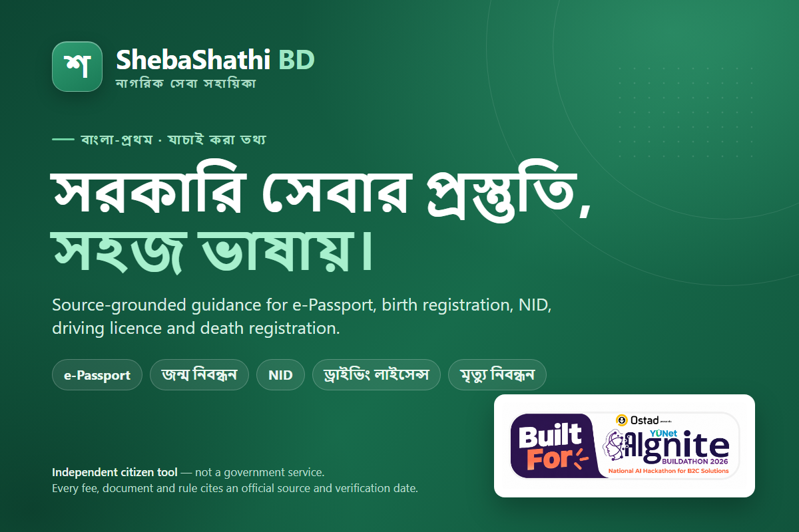

# ShebaShathi BD

### Bangla-first, source-grounded guidance for Bangladesh citizen services

**ShebaShathi BD** (সেবা সাথী বিডি) is an independent citizen-help platform. It explains what documents people need, what an official service costs, how a process works, and where the official portal is — in **Bangla and English**.

Every fee, document and rule shown to a user comes from a dated official source. The project is **not a government website**, does not submit applications, and does not store identity data.

[](https://nextjs.org/)
[](https://react.dev/)
[](https://tailwindcss.com/)
[](https://fastapi.tiangolo.com/)
[](https://www.trychroma.com/)
[](https://github.com/Soumitra-32/ShebaShathi)



> **New here?** Read [What it does](#what-it-does) and [Key concepts](#key-concepts) first.
>
> **Setting it up?** Jump to [Quick start](#quick-start).
>
> **Reviewing the project?** See [Architecture](#architecture), [Privacy and security](#privacy-and-security) and [Current status](#current-status).

---

## Contents

- [Overview](#overview)
- [What it does](#what-it-does)
- [What it does not do](#what-it-does-not-do)
- [Key concepts](#key-concepts)
- [Features](#features)
- [Supported services](#supported-services)
- [Architecture](#architecture)
- [Design principles](#design-principles)
- [Technology stack](#technology-stack)
- [Project structure](#project-structure)
- [Quick start](#quick-start)
- [Configuration](#configuration)
- [API reference](#api-reference)
- [Data, sources and freshness](#data-sources-and-freshness)
- [Privacy and security](#privacy-and-security)
- [Testing and quality checks](#testing-and-quality-checks)
- [Deployment](#deployment)
- [Current status](#current-status)
- [Known limitations](#known-limitations)
- [Documentation](#documentation)
- [License and reuse](#license-and-reuse)
- [Disclaimer](#disclaimer)

---

## Overview

Citizen-service information is spread across multiple government portals and is often difficult to interpret. A person may not know:

- which service or task applies to their situation;
- which documents are required for their specific case;
- what the official fee is and whether a quoted price is too high;
- how to check a document for simple text differences;
- how to prepare a complaint without sending personal details to another website.

ShebaShathi BD brings those pieces together in one bilingual interface. It combines **deterministic rules**, **retrieval-grounded answers**, and **browser-only tools** so that useful help does not require collecting sensitive personal data.

The product was built for **AIgnite 2026** as a hackathon MVP and now covers **six service areas**.

---

## What it does

| Need | How ShebaShathi BD helps |
|---|---|
| “Which service do I need?” | A guided intake asks for a short, non-sensitive description and routes it to a service and task. |
| “What documents should I prepare?” | A conditional checklist is built from verified service rules and the minimum answers required. |
| “How much should this cost?” | A verified fee catalog shows official amounts, breakdowns, source links and verification dates. |
| “Is this quote too high?” | The fee checker compares a claimed amount with the verified schedule **in the browser**. |
| “Can I ask a follow-up question?” | A grounded AI assistant answers from retrieved official excerpts and attaches citations. |
| “I need to write a complaint.” | A deterministic complaint drafter creates an editable Bangla/English draft locally. |
| “Do my documents agree?” | A browser-only consistency checker reads document text and highlights field differences. |
| “Can I dictate instead of typing?” | Local Whisper speech recognition runs in the browser; audio and transcripts never leave the device. |

---

## What it does not do

ShebaShathi BD is deliberately limited:

- **It is not a government service** and is not affiliated with any authority.
- **It does not submit applications**, make payments, book appointments, or log in to government portals.
- **It does not authenticate people or documents**, decide eligibility, or state which value is legally correct.
- **It does not accept or store NID, birth-registration, passport or licence numbers**, document images, OTPs, credentials, complaint text, OCR output, voice audio or transcripts on the server.
- **It does not use cloud OCR or cloud speech recognition.**
- **It does not automate government portals**, bypass CAPTCHAs/OTPs, or scrape authenticated pages.
- **It does not use an LLM to choose fees, documents, deadlines or rules.** Those come from validated data.

---

## Key concepts

| Term | Plain-language meaning |
|---|---|
| **Service guide** | A structured guide for one government service, such as e-Passport or birth registration. |
| **Task** | A specific job inside a service, such as first application, renewal or correction. |
| **Deterministic** | Computed by code and reviewed data — not generated by an AI model. Fees, documents and rules work this way. |
| **Grounded answer** | An AI answer that is checked against retrieved official excerpts. If the check fails, the app shows a cited excerpt or a safe fallback instead. |
| **Corpus** | The small, curated set of official-source snapshots used for retrieval. |
| **Verification date** | The date a human last confirmed a fact against its official source. |
| **Fallback** | The safe response shown when the app cannot verify an answer. It links to the official portal. |
| **Local-only** | Processing that happens entirely inside the browser; the data is never sent to the backend or a third party. |

---

## Features

### 1. Guided service preparation

- Six service areas with per-service, source-dated guides.
- Each service is organized as **task → short questionnaire → document checklist → manually marked phases → printable summary**.
- Conditional rules add or remove documents based on minimal, non-sensitive answers such as age or application type.
- Users can print a complete task guide or a progress summary.
- Unknown or unverified cases show the official portal and a safe fallback instead of a guess.

### 2. AI-assisted intake

- Available inside the assistant at **`/copilot#intake`**.
- Accepts a short description in **Bangla, English or Banglish**.
- An optional LLM only classifies the service/task; a deterministic keyword router takes over when no key is configured, the provider fails, or the output is invalid.
- The UI states which mode was used and asks only for missing non-sensitive answers.
- Identity-like numbers are rejected before any model call.

### 3. Grounded AI assistant

- Multi-turn chat at **`/copilot`**, with conversation history held in the browser.
- Deterministic fee, photo and status tools run first.
- Other questions are answered only from service-scoped retrieved sources.
- Every generated answer is checked against the cited chunks; unsupported numbers or URLs cause a cited/deterministic fallback.
- Answers include source citations, verification dates, chunk IDs and similarity scores where applicable.
- Deterministic status answers and the e-Passport fraud-shield card use the same source-dated official guidance.
- No LLM key is required: the assistant can answer in cited extractive mode.
- Optional **AI case brief** rewrites an already-verified checklist in plain language without adding facts.

### 4. Fee transparency

- A dedicated **`/fees`** section lists published service fees, official sources and verification dates.
- The **`/redflag`** fee checker lets users choose a service, enter the amount they were quoted, and compare it with the verified official breakdown.
- The calculation runs in the browser; the claimed amount is not sent to the server.
- Services without a verified schedule show **“manual verification required”** and link to the official portal.

### 5. Privacy-first local tools

| Tool | Route | Runs where |
|---|---|---|
| Complaint drafter | `/grs` | Browser (deterministic templates) |
| Local voice input | `/grs` | Browser (self-hosted Whisper/ONNX) |
| Document consistency check | `/identity-check` | Browser (PDF.js + Tesseract.js OCR) |
| Fee comparison | `/redflag` | Browser |
| Checklist intake | `/copilot#intake` | Backend rules + optional LLM classification |
| Grounded assistant | `/copilot` | Backend retrieval + optional LLM generation |

### 6. Source freshness

- Every user-facing fact carries its **official source URL** and **verification date**.
- A daily GitHub Actions workflow checks official pages for changes.
- A detected change is marked **`pending_review`** for a human reviewer; it is never promoted to a rule automatically.
- The UI shows `last_checked` (when the page was fetched) separately from `last_verified` (when a human confirmed the rule).

### 7. Bilingual and accessible by default

- Bangla is the default language, with an English toggle.
- Every user-facing string has `bn` and `en` versions.
- Mobile-first layout with printable Bangla output using the bundled Noto Sans Bengali font.

---

## Supported services

| Service | Supported tasks | Official authority | Official portal |
|---|---|---|---|
| **e-Passport** | First application (adult), minor, renewal, lost passport | Department of Immigration and Passports | [epassport.gov.bd](https://epassport.gov.bd/) |
| **Birth registration** | New registration, correction, reprint, cancellation, verification, status | Office of the Registrar General, Birth and Death Registration | [bdris.gov.bd](https://bdris.gov.bd/) |
| **National ID (NID)** | New registration, correction, reissue | Bangladesh Election Commission (NID Wing) | [services.nidw.gov.bd](https://services.nidw.gov.bd/) |
| **Driving licence** | Learner, smart card, renewal, duplicate | Bangladesh Road Transport Authority (BRTA) | [bsp.brta.gov.bd](https://bsp.brta.gov.bd/drivingLicense) |
| **Death registration** | New registration, correction, reprint, verification | Office of the Registrar General, Birth and Death Registration | [bdris.gov.bd/dr](https://bdris.gov.bd/dr/application) |
| **Land mutation** | New mutation, review, track status | Ministry of Land | [mutation.land.gov.bd](https://mutation.land.gov.bd/nirdeshika) |

Service rules live in `data/services/*.json`. The loader fails closed if a rule is missing a `service_id`, an `https` source URL, or a verification date.

---

## Architecture

```text
┌──────────────────────────────────────────────────────────────────────┐
│ Browser — Next.js 15 (App Router), Tailwind CSS, Bangla/English      │
│                                                                      │
│  Local-only tools                     Server-backed tools            │
│  • complaint drafting                 • service guides               │
│  • OCR / PDF text extraction          • conditional checklists       │
│  • document comparison                • grounded copilot             │
│  • voice input (Whisper)              • verified fee catalog         │
│  • fee comparison                     • AI intake / case brief       │
└───────────────────────────────┬──────────────────────────────────────┘
                                │ REST / JSON
┌───────────────────────────────▼──────────────────────────────────────┐
│ FastAPI backend                                                      │
│  • validated service catalog + deterministic rule engine             │
│  • intake router (rules + optional LLM classifier)                   │
│  • RAG: retrieve → filter by service_id → verify → optional LLM      │
│  • privacy screen, rate limiting, safe error responses               │
└───────────────────────────────┬──────────────────────────────────────┘
                                │
          data/services/*.json  │  corpus/*.md ──ingest──► vector index
```

**The model is never the policy engine.** It may classify intent and explain retrieved text. It cannot choose a fee, document, deadline or rule.

---

## Design principles

1. **No hallucinated facts.** Every fee, document, rule, deadline and URL must come from verified data or a retrieved corpus chunk with a source and date. Otherwise the app shows a safe fallback.
2. **Deterministic first.** Fees, checklists, eligibility and routing are code/config. The LLM is optional and constrained.
3. **Privacy by design.** Sensitive workflows run in the browser. The backend has no database of personal data, no accounts and no analytics.
4. **Bangla first.** Bangla is the default; every user-facing string is available in Bangla and English.
5. **Verify, do not assume.** A daily source check surfaces changes for human review; it never rewrites guide content automatically.
6. **Graceful degradation.** The product still works without an LLM key, without OCR models, and with offline fallback to previously cached public responses where available.

---

## Technology stack

| Layer | Technology | Purpose |
|---|---|---|
| Frontend | Next.js 15 (App Router), React 18, TypeScript | Routes, server rendering and client UI |
| Styling | Tailwind CSS 3 | Responsive, mobile-first interface |
| Internationalization | i18next / react-i18next | Bangla and English copy |
| Icons | lucide-react | Accessible iconography |
| Local OCR | Tesseract.js + self-hosted `ben`/`eng` data | Read scanned documents in the browser |
| Local PDF | PDF.js | Extract text from PDFs in the browser |
| Local speech | Transformers.js + ONNX Runtime Web + Whisper | Browser-side dictation |
| Backend | FastAPI, Pydantic v2, Uvicorn | REST API, validation and error handling |
| Retrieval | ChromaDB (dev/build), NumPy index option (production) | Service-scoped vector search |
| Embeddings | `intfloat/multilingual-e5-small` | Multilingual retrieval for Bangla and English |
| LLM (optional) | Any OpenAI-compatible chat-completions endpoint | Intent classification and grounded explanation |
| Data | JSON service contracts + Markdown corpus | Source of truth for rules and retrieval |
| Deployment | Docker Compose, Render, Vercel | Local and production deployment options |

---

## Project structure

```text
.
├── backend/app/
│   ├── main.py                  FastAPI app, routes, error handlers, CORS
│   ├── config.py                Environment settings
│   ├── schemas.py               Pydantic request/response models
│   ├── engine/                  Deterministic fee, checklist and red-flag logic
│   ├── services/                Catalog loader, conditional engine, freshness, refresh
│   ├── intake/                  Free-text → service/task router
│   ├── rag/                     Ingest, retrieval, generation, verifier, guards, tools
│   ├── guidance/                Verified status and fraud-shield guidance
│   ├── privacy.py               Identity-number and sensitive-data screens
│   ├── rate_limit.py            Process-local sliding-window limiter
│   ├── llm.py                   OpenAI-compatible adapter (OpenRouter-aware)
│   └── tests/                   pytest suite and evaluation data
├── corpus/                      Curated official-source snapshots with front matter
├── data/
│   ├── services/*.json          Six validated service contracts
│   ├── fee_schedules.json       Verified fee catalog for six services
│   ├── fees.json                Legacy e-Passport fee data
│   ├── requirements.json        Legacy e-Passport requirement data
│   └── VERIFICATION_LOG.md      Human verification record
├── frontend/
│   ├── app/                     Next.js routes
│   ├── components/              Shared UI components
│   ├── lib/                     API client, i18n, fee and intake helpers
│   ├── lib/local/               Browser-only OCR, PDF, compare, complaint, speech
│   ├── locales/                 bn.json and en.json
│   └── public/                  Self-hosted runtimes, models and static assets
├── ml_core/                     Shared embedder — treated as frozen
├── scripts/                     Maintenance, refresh and verification scripts
├── docs/                        Product, security, privacy, deployment and evaluation docs
├── docker-compose.yml           Local two-service stack
├── render.yaml                  Render backend blueprint
└── .env.example                 Environment template (no real secrets)
```

---

## Quick start

### Prerequisites

- **Python 3.11+**
- **Node.js 20+** and npm
- Optional: **Docker** for the containerized setup
- Network access on first run to download the embedding model and local OCR/voice assets

### 1. Clone the repository

```bash
git clone https://github.com/Soumitra-32/ShebaShathi.git
cd ShebaShathi
```

### 2. Create your environment file

```powershell
Copy-Item .env.example .env
```

Edit `.env` if needed. The app runs without an LLM key; the assistant then uses cited extractive answers and intake uses the deterministic router.

> **Never commit `.env`.** Only placeholders belong in `.env.example`.

### 3. Start the backend

From the repository root:

```powershell
python -m venv .venv
.\.venv\Scripts\Activate.ps1
pip install -r backend/requirements-dev.txt
$env:PYTHONPATH = "backend"
python -m app.rag.ingest --rebuild
uvicorn app.main:app --reload --app-dir backend --env-file .env
```

- API: <http://localhost:8000>
- Interactive API docs: <http://localhost:8000/docs>
- Health check: <http://localhost:8000/health>

The embedding model downloads from Hugging Face on first indexing. Startup also warms the retrieval index; wait for `ai_ready: true` in `/health` before asking the first question. Set `WARM_RETRIEVAL=false` to skip warmup.

### 4. Start the frontend

In a second terminal:

```powershell
cd frontend
npm ci
npm run fetch-models
npm run dev
```

- App: <http://localhost:3000>

`npm ci` copies the local OCR, PDF and ONNX runtime into `frontend/public/`. `npm run fetch-models` downloads Tesseract language data (`ben`, `eng`) and the Whisper model **once** so the browser loads them from this project's own origin instead of a CDN. Without them, OCR and voice features explain that the local model is missing while manual input remains available.

Use `npm run fetch-models -- --model whisper-tiny` for the smaller Whisper model.

### 5. Run with Docker (optional)

Create `.env` first, then from the repository root:

```bash
docker compose up --build
```

The backend image indexes the bundled corpus at build time and persists the model cache in named volumes. The first model download may take several minutes.

### 6. Verify the installation

1. Open <http://localhost:3000>.
2. Check that `/health` reports `ai_ready: true`, `index_count > 0` and `service_count: 6`.
3. Open `/services` and confirm all six services appear.
4. Try a checklist in `/copilot#intake` and a question in `/copilot`.
5. Open `/grs`, `/identity-check` and `/redflag` and confirm the local tools load.

---

## Configuration

All settings come from environment variables. See [`.env.example`](.env.example) for the complete template.

### Core settings

| Variable | Default | Description |
|---|---|---|
| `CORS_ORIGINS` | `http://localhost:3000` | Comma-separated allowed frontend origins |
| `CHROMA_PERSIST_DIR` | `./.chroma` | Vector-store persistence directory |
| `EMBEDDING_MODEL` | `intfloat/multilingual-e5-small` | Multilingual embedding model |
| `EMBEDDING_BACKEND` | `torch` | `torch` for local development, `onnx` for the production image |
| `VECTOR_STORE` | `chroma` | `chroma` for development, `numpy` for the low-memory production image |
| `RAG_TOP_K` | `5` | Number of chunks retrieved per question |
| `RAG_MIN_SCORE` | `0.35` | Minimum similarity score for a usable chunk |
| `WARM_RETRIEVAL` | `true` | Warm the index at startup |
| `RATE_LIMIT_ENABLED` | `true` | Enable process-local rate limiting |
| `RATE_LIMIT_PER_MINUTE` | `60` | Limit for costly public endpoints |
| `INTAKE_RATE_LIMIT_PER_MINUTE` | `60` | Limit for the intake endpoint |

### Optional LLM settings

| Variable | Default | Description |
|---|---|---|
| `LLM_API_BASE` | `https://api.openai.com/v1` | Any OpenAI-compatible chat-completions endpoint |
| `LLM_MODEL` | `anthropic/claude-sonnet-4.6` | Primary model ID |
| `LLM_MODEL_FALLBACKS` | — | Comma-separated models tried in order on availability or quota errors |
| `LLM_API_KEY` | empty | Provider key; leave empty to disable external calls |
| `LLM_APP_TITLE` | — | Optional OpenRouter dashboard attribution |
| `LLM_HTTP_REFERER` | — | Optional OpenRouter dashboard attribution |

The default `.env.example` shows **OpenRouter** as the recommended provider. Swapping to OpenAI or another compatible endpoint only requires changing `LLM_API_BASE` and `LLM_MODEL`.

When no key is configured:

- intake uses the deterministic keyword router (`generation_mode: "rules"`);
- the copilot answers with cited source excerpts (`generation_mode: "extractive"`);
- no external model call is made.

### Frontend setting

| Variable | Default | Description |
|---|---|---|
| `NEXT_PUBLIC_API_URL` | `http://localhost:8000` | Backend URL baked into the frontend build |

---

## API reference

Base URL: `http://localhost:8000`. Full schemas and examples are available at `/docs`.

### Health and catalog

| Method | Endpoint | Description |
|---|---|---|
| `GET` | `/health` | Status, `service_count`, `index_count`, `ai_ready`, provider/model (never the key) |
| `GET` | `/api/services` | Enabled service catalog with tasks and review dates |
| `GET` | `/api/services/{service_id}` | Validated guide content, official links and source dates |
| `GET` | `/api/services/refresh-status` | Daily source-check status and `pending_review` flags |
| `GET` | `/api/services/{service_id}/status-guide` | Verified status guidance, fraud warnings and freshness |

### Checklists and AI

| Method | Endpoint | Description |
|---|---|---|
| `POST` | `/api/intake` | Map a short, non-sensitive description to a service/task and missing questions |
| `POST` | `/api/services/{service_id}/checklist` | Conditional checklist for a service task |
| `POST` | `/api/services/{service_id}/checklist/brief` | Plain-language explanation of a verified checklist |
| `POST` | `/api/copilot/ask` | Single grounded question with citations |
| `POST` | `/api/copilot/chat` | Multi-turn grounded chat with up to six browser-held turns |

### Fees and legacy endpoints

| Method | Endpoint | Description |
|---|---|---|
| `GET` | `/api/fee-schedules` | Public verified fee catalog (labels, amounts, sources, dates) |
| `POST` | `/api/fees/calculate` | Legacy e-Passport fee calculation |
| `POST` | `/api/checklist` | Legacy e-Passport checklist |
| `POST` | `/api/redflag/check` | Legacy server-side fee comparison |
| `POST` | `/api/grs/draft` | Server-side GRS draft (kept for API callers; the UI drafts locally) |

**API guarantees**

- Responses are JSON; errors use `{ "error": { "code": "...", "message": "..." } }`.
- Public request models reject unknown fields.
- No endpoint is designed to collect identity numbers, document files, OTPs or credentials; identity-like values are screened before provider calls.
- Tracebacks, file paths, prompts and secrets are never returned.
- Rate limits apply to costly AI endpoints.

---

## Data, sources and freshness

### Source of truth

| Location | Contents |
|---|---|
| `data/services/*.json` | Service contracts: tasks, questions, documents, steps, warnings, links |
| `data/fee_schedules.json` | Verified fee schedules for six services |
| `data/fees.json` | Legacy e-Passport fee table |
| `data/requirements.json` | Legacy e-Passport requirement rules |
| `data/VERIFICATION_LOG.md` | Human-recorded source checks and changes |
| `corpus/*.md` | Curated official-source snapshots used for retrieval |

Every corpus file must carry front matter including `service_id`, `source_url`, `last_verified`, `language` and `section`. Retrieval is always filtered by `service_id`, so answers cannot silently mix rules from different authorities.

### Two different dates

- **`last_verified`** — when a human last confirmed a rule against its official source.
- **`last_checked`** — when the daily automated check last fetched the official page.

A daily GitHub Actions workflow (`refresh-service-guides.yml`) performs a GET-only, robots-aware check of each service's public official URLs, stores a SHA-256 hash, and flags changes as `pending_review`. It never rewrites guide content or promotes a change to a user-facing rule.

### Refreshing a source

1. Review the official page.
2. Update the relevant `data/services/*.json` or `corpus/*.md` entry.
3. Record the check in `data/VERIFICATION_LOG.md`.
4. Rebuild the index:

```powershell
$env:PYTHONPATH = "backend"
python -m app.rag.ingest --rebuild
```

Rules must keep a `service_id`, an `https` `source_url` and a `last_verified` date. The loader fails closed otherwise.

---

## Privacy and security

ShebaShathi BD is designed so that sensitive data does not need to leave the browser.

### Runs locally in the browser

- Complaint drafting and formatting
- Voice dictation (self-hosted Whisper)
- Document OCR and PDF text extraction
- Document consistency comparison
- Fee comparison against a claimed amount
- Language preference

### Runs on the backend

- Service catalog and conditional checklist rules
- Verified fee catalog delivery
- Grounded retrieval and optional answer generation
- Intake classification (optional provider call after the identity-number screen)
- Safe error handling and rate limiting

### Data-handling rules

- No user accounts, database of personal data, analytics or telemetry.
- No NID, birth-registration, passport or licence numbers are requested, sent, logged or persisted.
- No document images, OCR output, voice audio or complaint text are sent to the backend.
- The LLM provider receives only the intake description or the copilot question, recent turns and retrieved excerpts — never documents, audio, complaint text or extracted identity values.
- Identities and credentials are screened before any provider call; a matching message is answered locally from verified excerpts.
- Only public GET responses and the language preference may be cached in `localStorage`.
- Security headers and a Content Security Policy are configured in `frontend/next.config.js`.

Read the full data-flow map in [`docs/PRIVACY.md`](docs/PRIVACY.md) and the required workflow in [`docs/SECURITY_ASSESSMENT.md`](docs/SECURITY_ASSESSMENT.md).

> Browser-local processing protects against unnecessary uploads. It does not protect against a compromised device, a malicious browser extension or malicious application code.

---

## Testing and quality checks

Run these before submitting a change.

### Backend

```powershell
$env:PYTHONPATH = "backend"
pytest backend/app/tests -q
python -m compileall -q backend/app
```

Optional live evaluation (requires a configured provider, network and budget):

```powershell
python backend/scripts/live_eval.py
```

### Frontend

```powershell
cd frontend
npm run lint
npx tsc --noEmit
npm test
npm run build
```

Optional browser-level checks (require Chrome or Edge and the relevant local assets):

```powershell
npm run verify:local      # OCR + PDF extraction on synthetic fixtures
npm run verify:speech     # local Whisper model loads and runs
npm run verify:privacy    # sensitive values never appear in requests, storage or console
npm run verify:intake     # intake, navigation, fee estimator and fraud-shield UI checks
```

`verify:intake` expects the backend on `http://localhost:8000` and the frontend on `http://localhost:3000`.

### Evaluation

The recorded live evaluation covers e-Passport questions and adversarial prompts. See [`docs/EVAL_RESULTS.md`](docs/EVAL_RESULTS.md) for the measured results and limitations. Offline tests mock retrieval and the LLM, so they verify wiring and safety behaviour rather than live factual accuracy.

The multi-service evaluation set is still an open task; see [`TESTING.md`](TESTING.md) and [`docs/PLANNER.md`](docs/PLANNER.md).

---

## Deployment

### Docker (local or demo)

```bash
docker compose up --build
```

- Frontend: <http://localhost:3000>
- Backend: <http://localhost:8000>

### Render backend + Vercel frontend

The repository includes a `render.yaml` blueprint. Step-by-step instructions, free-plan constraints and production checks are in [`docs/DEPLOYMENT.md`](docs/DEPLOYMENT.md).

Key production notes:

- The backend image bakes the retrieval index at build time.
- Production uses the ONNX int8 embedder and NumPy vector store to fit a 512 MB free-tier instance.
- Set `CORS_ORIGINS` to the exact frontend origin.
- Set `NEXT_PUBLIC_API_URL` before building the frontend.
- Keep `LLM_API_KEY` in the host secret store only.

No public deployment URL is claimed in this repository.

---

## Current status

| Area | Status |
|---|---|
| Service guides | Six services enabled: e-Passport, birth registration, NID, driving licence, death registration, land mutation |
| Guided workflow | Task selection, conditional checklists, manual phase tracking, printable guides and summaries |
| Fee catalog | Verified schedules for all six services |
| Grounded assistant | Multi-turn chat, deterministic tools, verifier, cited fallback |
| AI intake | Embedded at `/copilot#intake`, deterministic fallback without a key |
| Local tools | Complaint drafter, voice input, document consistency check, fee comparison |
| Source freshness | Daily automated check with human-review flagging |
| Evaluation | Recorded e-Passport evaluation; multi-service evaluation set pending |
| Production scale-out | Rate limiting is process-local; a shared store is needed for multiple instances |

The project is a **hackathon MVP**, not a production government service. Treat the cited official source and the deterministic checklist as authoritative.

---

## Known limitations

- Source snapshots are checked in manually and are not auto-refreshed into rules. Review them on a cadence and after official notices.
- The copilot only knows the small, curated corpus. It returns a safe fallback when retrieval or citation checks fail.
- The document consistency check compares text only; it does not authenticate a document, decide which value is legally correct, or read an image that is too unclear to OCR.
- Local Whisper dictation is usable but not perfect; the transcript is editable before use.
- Services without a verified fee schedule show “manual verification required” and link to the official portal.
- The intake classifier is a starting point, not an official decision. Ambiguous cases ask the user to choose a service or task.
- Identity-number screening is shape-based and intentionally conservative; it can miss an unusual format.
- Rate limiting is process-local. A multi-instance deployment needs a shared store such as Redis.
- Generated text can vary between runs. The verifier blocks unsupported numbers and URLs, but it cannot prove every paraphrase is ideal.
- The CSP currently allows `'unsafe-inline'` scripts because of Next.js requirements.
- No live deployment URL or recorded demo video is included in this repository.

---

## Documentation

| Document | What it covers |
|---|---|
| [`AGENTS.md`](AGENTS.md) | Hard rules and the mandatory workflow for contributors and coding agents |
| [`ARCHITECTURE.md`](ARCHITECTURE.md) | Component map, data contracts and key flows |
| [`CONVENTIONS.md`](CONVENTIONS.md) | Code style and project conventions |
| [`TESTING.md`](TESTING.md) | Test commands, required coverage and manual checks |
| [`DECISIONS.md`](DECISIONS.md) | Chronological architecture and product decisions |
| [`docs/PLANNER.md`](docs/PLANNER.md) | Scope, phases, acceptance criteria and roadmap |
| [`docs/PRIVACY.md`](docs/PRIVACY.md) | Privacy model and local-processing data flows |
| [`docs/SECURITY_ASSESSMENT.md`](docs/SECURITY_ASSESSMENT.md) | Mandatory security workflow and abuse-case review |
| [`docs/DEPLOYMENT.md`](docs/DEPLOYMENT.md) | Render + Vercel deployment guide |
| [`docs/EVAL_RESULTS.md`](docs/EVAL_RESULTS.md) | Evaluation evidence and limitations |
| [`docs/DEMO_SCRIPT.md`](docs/DEMO_SCRIPT.md) | Three-minute demo script and recording checklist |
| [`docs/UX_CHECKS.md`](docs/UX_CHECKS.md) | Local UX check notes |
| [`data/VERIFICATION_LOG.md`](data/VERIFICATION_LOG.md) | Recorded official-source verification dates and changes |

---

## License and reuse

This repository does not currently include a `LICENSE` file. Until a license is added, reuse, redistribution or commercial use requires permission from the maintainers.

---

## Disclaimer

**ShebaShathi BD is an independent citizen-help tool, not a government website.** It does not represent, replace or act on behalf of any government authority. Always confirm final requirements, fees, deadlines and procedures on the relevant official portal before taking action.

Built for **AIgnite 2026**.
